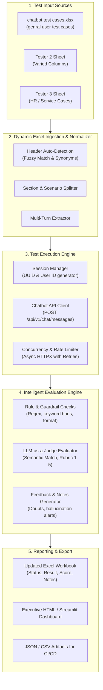

# Automated Chatbot Testing System Architecture & Implementation Plan

## 1. Executive Summary

This document outlines the architecture, design, and roadmap for building an **Automated Chatbot Testing & Evaluation System**. 
The system automatically ingests test scenarios from Excel workbooks created by multiple QA testers, executes the conversational and functional tests against the company's chatbot backend API, evaluates the responses using an intelligent hybrid evaluation engine (Rule-based + LLM-as-a-Judge), and writes detailed scores (1–5), statuses, verdicts (PASS/FAIL/PARTIAL), and actionable notes back into Excel and interactive dashboards.

---

## 2. Key Challenges & System Requirements

| Challenge / Requirement | Root Cause in Current Sheets | Proposed Solution |
| :--- | :--- | :--- |
| **Multiple Tester Formats (3–4 sheets)** | Different testers use varying column headers (e.g., `Test Data` vs `Prompt`, `Expected Result` vs `Expected Output`), blank spacer rows, and embedded scenario headers. | **Flexible Schema Normalizer**: Fuzzy column mapping + section header detector + automatic empty-row purging. |
| **Multi-Turn Dialogues** | Some test cases contain sequential interactions (e.g., *"First: I want a website. Second: How much will it cost?"*). | **Session-Aware Turn Orchestrator**: Parses turns, maintains conversation `uuid`, passes chat history sequentially to test contextual memory. |
| **Subjective vs Exact Comparison** | Chatbots generate non-deterministic natural language. Exact string matching (`==`) always fails for generative AI. | **Hybrid Evaluation Engine**: Combines regex/guardrail checks (e.g. checking for forbidden pricing commitments) with an LLM Judge scoring semantic alignment on a 1–5 scale. |
| **Sheet Integrity & Styling** | Modifying Excel files often breaks formatting, cell merges, fonts, and formulas. | **Non-Destructive openpyxl Engine**: Preserves original fonts, fills, and alignments; writes into target columns (`Test Status`, `Test result`, `Score`, `Actual Output`, `Test Notes`), and outputs a timestamped `_TESTED.xlsx`. |
| **Lead & Backend Integration** | Tests involving lead generation (e.g., Client Detection Emails, DB records) require more than just reading the text reply. | **Dual-Assertion Runner**: Checks the HTTP response body + optional verification of lead creation via backend API/DB. |

---

## 3. High-Level Architecture



---

## 4. Evaluation Rubric & Scoring System (1–5)

To ensure consistent, objective scoring across all tester scenarios, the automated judge evaluates on a standardized rubric:

| Score | Rating | Verdict | Criteria Description | Example |
| :---: | :---: | :---: | :--- | :--- |
| **5** | **Excellent / Flawless** | `PASS` | Response perfectly fulfills the expected intent, includes all required details, maintains correct polite tone, follows guardrails (e.g., politely asks for requirements before quoting price), and contains zero hallucinations. | Expected: "Ask for clarification on vague query."<br>Bot: "I'd be glad to help! Could you clarify if you are looking for web or mobile software?" |
| **4** | **Good / Minor Variance** | `PASS` | Core answer is accurate and completely answers the primary scenario, but has minor phrasing differences or misses a non-critical secondary nuance. | Expected: "List software services."<br>Bot lists 5 core services accurately, omitting only one minor sub-service. |
| **3** | **Acceptable / Partial** | `PARTIAL` | Answers the question partially or is slightly vague; key information or required clarifying prompt was only half-addressed. Requires human QA review. | Expected: "Ask for email and phone number."<br>Bot asks for email but forgets to ask for phone number. |
| **2** | **Poor / Misaligned** | `FAIL` | Missed the primary intent, gave generic evasive response, or gave outdated/inaccurate company info without outright crashing. | Expected: "Explain mobile development tech stack."<br>Bot: "We do many things, check our website." |
| **1** | **Critical Failure** | `FAIL` | Hallucination, fabricated pricing/policies, security policy breach (prompt injection leak), broke negative test condition, or HTTP 500 error. | Expected: "Avoid giving exact price without requirements."<br>Bot: "A website costs exactly ₹15,000." |

---

## 5. Detailed Component Breakdown

### Component 1: Schema Normalizer (`excel_parser.py`)
- **Fuzzy Header Mapping**:
  ```python
  COLUMN_SYNONYMS = {
      "test_id": ["test id", "tc id", "scenario id", "s.no", "id"],
      "feature": ["feature", "module", "component"],
      "test_type": ["test type", "type", "category"],
      "description": ["test description", "description", "summary"],
      "precondition": ["precondition", "prerequisites"],
      "steps": ["test steps", "steps", "procedure"],
      "input_data": ["test data", "query", "user message", "input", "prompt"],
      "expected": ["expected result", "expected output", "expected response"],
      "remark": ["remark", "notes", "comments", "tester notes"],
      "test_status": ["test status", "status"],
      "test_result": ["test result", "result", "verdict"],
  }
  ```
- **Section Parsing**: Handles files where multiple scenarios are stacked with divider titles like `Scenario ID 01 General User`.
- **Spacer Row Handling**: Safely ignores alternating empty rows while preserving exact row numbers for write-back.

### Component 2: Execution Engine (`chat_runner.py`)
- **API Target**: Calls the FastAPI endpoint `POST /api/v1/chat/messages`:
  ```json
  {
    "user_id": "1",
    "uuid": "3fa85f64-5717-4562-b3fc-2c963f66afa6",
    "query": "What software development services do you offer?"
  }
  ```
- **Multi-Turn Support**:
  - Automatically identifies patterns such as:
    `First: I want to build a website. Second: How much will it cost?`
    or `1: ... 2: ...`
  - Sends turn 1, captures response, sends turn 2 with the **same `uuid` session** to verify multi-turn context memory.
- **Resilience**: Configurable concurrency (1–5 threads), per-request timeouts (30s), rate-limiting delays to prevent backend saturation, and automatic retries.

### Component 3: LLM Judge & Evaluator (`evaluator.py`)
- Evaluates the response using structured prompt output (JSON schema):
  ```json
  {
    "score": 5,
    "result": "PASS",
    "reasoning": "The chatbot accurately listed company services and followed company knowledge.",
    "missed_points": [],
    "suggestions": "None. Response is concise and accurate."
  }
  ```
- Supports OpenAI, Google Gemini, or local models via standard API keys in `.env`.
- Rule-based fast fail for deterministic checks (status code != 200, empty reply, regex match on forbidden terms).

### Component 4: Excel Writer & Reporting (`excel_writer.py`)
- Writes directly back to the matching rows in the original layout:
  - Column `Test Status` -> `Tested`
  - Column `Test result` -> `Pass` / `Fail` / `Partial`
  - New Column: `Actual Response` -> The full chatbot response
  - New Column: `Score (1-5)` -> `5`
  - New Column: `Test Notes` -> Detailed evaluation notes and suggestions
- Color coding:
  - Green for `Pass` (Score 4–5)
  - Yellow for `Partial` (Score 3)
  - Red for `Fail` (Score 1–2)
- Saves to a new file `chatbot_test_cases_EVALUATED_<timestamp>.xlsx` so the original file is never damaged.

---

## 6. Project Directory Structure

```
d:/Desktop/Automatic Testing/
│
├── chatbot test cases.xlsx             # Original input workbook
├── AUTOMATED_TESTING_ARCHITECTURE.md    # This architecture specification
├── config.yaml                         # API URLs, thresholds, column synonym mappings
├── .env.example                        # API keys (OpenAI / Gemini), Backend URLs
│
├── core/
│   ├── __init__.py
│   ├── parser.py                       # Universal Excel loader & normalizer
│   ├── runner.py                       # HTTP client, session & multi-turn manager
│   ├── judge.py                        # Rule checks + LLM evaluation logic
│   └── writer.py                       # OpenPyXL styler & Excel report writer
│
├── run_tests.py                        # Main CLI entrypoint
├── app_ui.py                           # Optional Streamlit Web Dashboard for QA team
└── reports/                            # Output folder for evaluated Excel & HTML reports
```

---

## 7. Next Steps & Questions for Alignment

Before we generate the complete code and run the pipeline, let's align on:
1. **Chatbot Host & Port**: Is the chatbot running locally at `http://localhost:8000` or deployed on a staging server?
2. **Evaluator Model**: Would you prefer Google Gemini (`gemini-2.5-flash` / `gemini-1.5-pro`) or OpenAI (`gpt-4o-mini`) for the LLM judge?
3. **Execution Scope**: Would you like to run a small pilot batch (e.g. 5–10 cases from Scenario 1) first to review the output format before running all 250+ cases?
