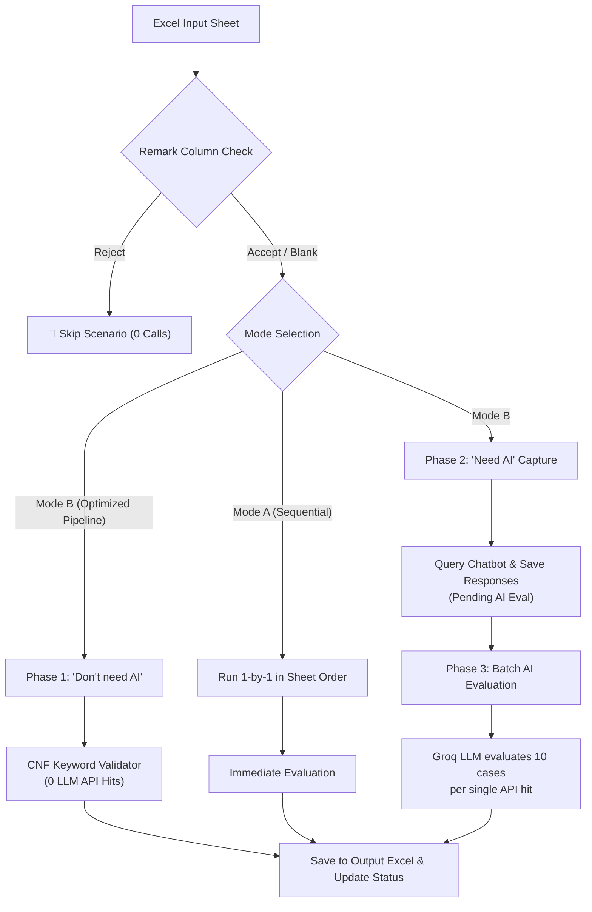

# 🤖 Hybrid Chatbot Testing Automation — QA Tester Guide

> **Version:** 2.0  
> **Target Audience:** QA Engineers, Automation Testers, and Product Leads  
> **Key Goal:** Fully automate chatbot regression testing from Excel, supporting both deterministic keyword matching (0 LLM cost) and intelligent AI batch evaluation (~90% API hit savings).

---

## 📌 Table of Contents
1. [System Overview & Working Logic](#1-system-overview--working-logic)
2. [Execution Modes (Mode A vs Mode B)](#2-execution-modes-mode-a-vs-mode-b)
3. [Tester Guide: How to Prepare the Excel Sheet](#3-tester-guide-how-to-prepare-the-excel-sheet)
4. [Keyword Formatting Rules (CNF Logic)](#4-keyword-formatting-rules-cnf-logic)
5. [Multi-Turn Scenario Handling](#5-multi-turn-scenario-handling)
6. [Scoring Rubric & Verdicts](#6-scoring-rubric--verdicts)
7. [Running the Automation (Commands & CLI Flags)](#7-running-the-automation-commands--cli-flags)
8. [Tester Pre-Flight Checklist](#8-tester-pre-flight-checklist)

---

## 1. System Overview & Working Logic

The automation engine reads test cases directly from an Excel spreadsheet, interacts with the live chatbot API (or visually in Cypress browser UI), logs real-time responses, and writes evaluation results, scores, and feedback back into a newly generated run spreadsheet without altering original templates.



### Core Gatekeepers & Rules:
1. **Remark Column Gatekeeper (Runs First):**
   - If `Remark` contains `Reject` (case-insensitive), the scenario is **immediately skipped**. Zero chatbot queries and zero LLM calls are made.
2. **Deduplication / Resume Support:**
   - Test cases already marked as `Tested` in previous runs are automatically skipped.
   - Use `--force` to re-evaluate already tested scenarios.
3. **Graceful Early Quit:**
   - Press `q` or `Ctrl+C` at any time to stop safely. All rows tested up to that second are preserved and saved into the output Excel file.

---

## 2. Execution Modes (Mode A vs Mode B)

You can select the mode at launch (interactive prompt) or via the `--mode` flag:

| Feature | 🔄 Mode A (Standard Sequential) | 🚀 Mode B (Optimized Pipeline - Recommended) |
| :--- | :--- | :--- |
| **Execution Order** | Exact sheet order (1-by-1) | Phase 1 (No-AI) $\rightarrow$ Phase 2 (Capture AI) $\rightarrow$ Phase 3 (Batch AI) |
| **No-AI Cases** | Evaluated via CNF keywords immediately | Evaluated in Phase 1 with **0 LLM API hits** |
| **Need-AI Cases** | Evaluated 1-by-1 with individual LLM calls | Captured first, then evaluated in **batches of 10 per LLM hit** |
| **LLM API Savings** | Standard (1 API hit per AI case) | **~90% reduction in LLM API hits** |
| **Best Used For** | Fast single-case debugging (`--test-id X`) | Full suite runs, regression testing, pilot batches |

---

## 3. Tester Guide: How to Prepare the Excel Sheet

To ensure the automation engine reads and evaluates your test cases properly, format your Excel sheet with the following standard columns:

### Required & Input Columns (Prepared by Tester)

| Col # | Column Name | Supported Synonyms | Description / Tester Guidance |
| :---: | :--- | :--- | :--- |
| **3** | `Test id` | `tc id`, `scenario id`, `id` | Unique ID (e.g. `1`, `TC-05`, `26`). |
| **4** | `Feature` | `module`, `component` | Feature name (e.g. `Lead Collection`, `Pricing`). |
| **5** | `Test Type` | `type` | `Functional`, `Negative`, `Guardrail`, `Context`. |
| **6** | `Test Description` | `description` | Brief explanation of what is being tested. |
| **7** | `Precondition` | `pre-condition` | Initial conditions required before test. |
| **8** | `Test Steps` | `steps`, `actions` | Step-by-step actions (optional fallback for queries). |
| **9** | `Test Data` | `query`, `input data`, `input` | **The exact prompt(s) sent to the bot.** Can be a single question or multi-turn script (`Turn 1: ... \nTurn 2: ...`). |
| **10** | `Expected Result` | `expected` | The business expectation for the bot's answer. |
| **11** | `Remark` | `remarks`, `decision`, `approval` | **Set to `accept` to test, or `Reject` to skip.** |
| **17** | `AI Evaluation?` | `ai evaluation`, `ai eval`, `eval mode` | **`Don't need AI`** = Deterministic keyword validation.<br/>**`Need AI`** = Groq LLM evaluation. |
| **18** | `Expected Keywords` | `expected keywords`, `keywords`, `mandatory keywords` | Keywords in CNF format `[{...}, {...}]` (required if `Don't need AI`). |

### Output Columns (Populated Automatically by Automation)

| Col # | Column Name | What Automation Writes |
| :---: | :--- | :--- |
| **12** | `Test Status` | `Tested` (or `Response Captured (Pending AI Eval)` in intermediate phase). |
| **13** | `Test result` | `PASS`, `PARTIAL`, or `FAIL`. |
| **14** | `Actual Output` | Full bot reply or multi-turn dialogue transcript (`Turn 1 User / Bot ...`). |
| **15** | `Score (1-10)` | Integer score from `1` to `10`. |
| **16** | `Test Notes / AI Feedback` | Detailed reasoning: matched keywords, missing groups, or AI evaluation comments. |

---

## 4. Keyword Formatting Rules (CNF Logic)

For test cases marked as **`Don't need AI`**, the system uses **Conjunctive Normal Form (CNF)** keyword matching:
- **Outer brackets `[...]` represent AND (Mandatory):** Every group inside must be satisfied.
- **Inner braces `{...}` represent OR (Synonyms):** If *any* keyword inside the curly braces matches, that group passes.

### Syntax Examples

#### Example 1: Basic Concept Matching
```text
[{pricing, cost, quote, quotation}, {sales team, contact us, email}]
```
- **Rule:** The bot response must contain at least one pricing term (`pricing` OR `cost` OR `quote` OR `quotation`) **AND** at least one contact term (`sales team` OR `contact us` OR `email`).

#### Example 2: Name & Project Intake
```text
[{Rahul, Rahul Sharma}, {email, phone, number, contact, project, requirements}]
```
- **Rule:** Must match `Rahul` (or `Rahul Sharma`) **AND** at least one required lead detail term.

### Pass / Fail Criteria for Keyword Validation:
- ✅ **PASS (Score: 10/10):** All mandatory groups are satisfied.
- ❌ **FAIL (Score: 2/10):** Any group is missing. No LLM fallback is needed; feedback clearly indicates which group failed.

---

## 5. Multi-Turn Scenario Handling

When a scenario requires testing a back-and-forth conversation (e.g. Test ID 26):

### How to Write Multi-Turn Queries in `Test Data`:
```text
Turn 1: Hi
Turn 2: Explain your services and delivery process in detail.
Turn 3: Now summarize that in exactly three bullet points.
Turn 4: Make it simpler for a non-technical person.
```
*(Also supports `1. ... \n2. ...`, `Query 1: ...`, or `First: ... \nSecond: ...`)*

### How the Engine Executes Multi-Turn Tests:
1. Generates a fresh, isolated `session_uuid` and `user_id`.
2. Sends `Turn 1`, waits for the reply, logs it in real time.
3. Sends `Turn 2` **using the same session**, allowing the bot to retain context from Turn 1.
4. Repeats for all turns, then aggregates the full dialogue into `Actual Output`.

### How to Format Keywords for Multi-Turn (`Don't need AI`):

#### Format A: Per-Turn Keywords (Recommended for Turn-by-Turn Precision)
Assign specific keyword requirements to each turn individually:
```text
Turn 1: [{hello, hi, welcome}]
Turn 2: [{services, software, web application}, {delivery, process}]
Turn 3: [{three, 3}, {bullet, points, summary}]
Turn 4: [{simple, non-technical, easy}]
```
- **Evaluation:** Turn 1 Bot reply must match Turn 1 groups; Turn 2 reply must match Turn 2 groups, etc.
- **Fail isolation:** Pinpoints the exact turn that failed (e.g. `Turn 3 missing [{three, 3}]`).

#### Format B: Global Multi-Turn Keywords
```text
[{hello, hi}, {services, software}, {bullet, points}]
```
- **Evaluation:** Checks across all bot responses combined in the conversation.

---

## 6. Scoring Rubric & Verdicts

| Score | Verdict | Criteria |
| :---: | :---: | :--- |
| **9 – 10** | **PASS** | Flawless match. Satisfies expected result completely, appropriate tone, zero hallucinations. |
| **7 – 8** | **PASS** | Solid match. Core expectation is fully met with minor acceptable phrasing differences. |
| **5 – 6** | **PARTIAL** | Partially met. Answered part of the question; missed secondary constraint. Needs tester review. |
| **3 – 4** | **FAIL** | Poor match. Missed primary intent, generic evasive response, or inaccurate info. |
| **1 – 2** | **FAIL** | Critical failure. Negative constraint broken (e.g. unauthorized price quote), hallucination, or server error. |

---

## 7. Running the Automation (Commands & CLI Flags)

### Common Commands

```bash
# 1. Run full suite in Mode B (Optimized Batch - Recommended)
python run_automation.py --mode B

# 2. Run first 10 pilot cases
python run_automation.py --pilot --mode B

# 3. Run a specific single Test Case by ID (e.g. Test ID 26)
python run_automation.py --test-id 26 --mode B

# 4. Force re-test even if rows are already marked as 'Tested'
python run_automation.py --force --mode B

# 5. Run a specific single test case with force re-evaluation
python run_automation.py --test-id 26 --force --mode B

# 6. Run sequentially in Mode A (1-by-1)
python run_automation.py --mode A

# 7. Run visually in Cypress Desktop Browser UI
python run_automation.py --ui --mode B

# 8. Run against a custom Excel file or sheet
python run_automation.py --file "input/my_custom_sheet.xlsx" --sheet "Sheet1" --mode B
```

### CLI Flag Reference

| Flag | Argument | Description |
| :--- | :--- | :--- |
| `--mode` | `A` or `B` | `A` = Standard Sequential, `B` = Optimized Batch (No-AI first + Batch AI). |
| `--test-id` | `ID` | Run only the targeted Test ID (e.g. `--test-id 5`). |
| `--force` | None | Re-run and re-score scenarios even if already marked as `Tested`. |
| `--pilot` | None | Runs only the first 10 eligible test cases. |
| `--limit` | `N` | Limits the run to `N` test cases. |
| `--ui` | None | Runs tests visually in the Cypress headed browser window. |
| `--delay` | `seconds` | Delay in seconds between test cases (default: `2.0s`). |

---

## 8. Tester Pre-Flight Checklist

Before clicking run or triggering a regression suite, verify:

1. [ ] **Input File Location:** Your sheet is placed inside the `input/` folder.
2. [ ] **Remark Column:** Unwanted/draft scenarios are set to `Reject`; active ones to `accept` (or blank).
3. [ ] **Classification:** Ensure `AI Evaluation?` has either `Don't need AI` or `Need AI`.
4. [ ] **Keywords Syntax:** If `Don't need AI`, verify `Expected Keywords` uses valid CNF syntax: `[{group1_a, group1_b}, {group2_a}]`.
5. [ ] **Multi-Turn Formatting:** Multi-turn scenarios clearly use `Turn 1: ... \nTurn 2: ...` in the `Test Data` column.
6. [ ] **Check Results:** After the run, open the newly generated file in `output/chatbot_test_cases_RUN_YYYYMMDD_HHMMSS.xlsx`.

---
*For technical questions, architecture diagrams, or customization instructions, refer to `AUTOMATED_TESTING_ARCHITECTURE.md` or consult the project lead.*

